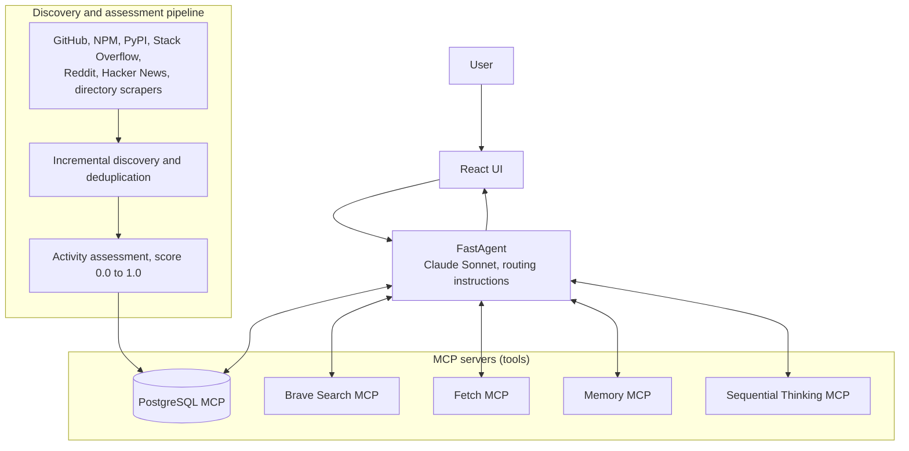
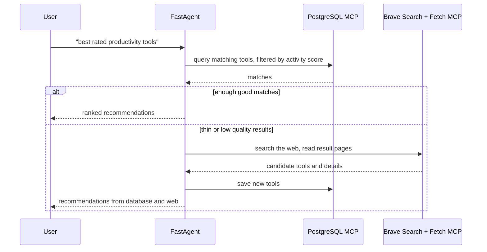

# AI Tools Intelligence Platform

An agent built with FastAgent and MCP that recommends AI tools from a quality-scored database and falls back to live web research when the database is not enough. Built during my internship at Acuvity (summer 2025). My role covered the agent's tool wiring, the database logic, and the discovery workflow that fills the database.

**Demo video:** https://drive.google.com/file/d/1p7ufd7qBizt5-jOStTEVf8iNCaVeCwQ1/view?usp=sharing

**Quick start:** [jump to Quick Start](#4-quick-start) (runs locally with Docker Compose)

## Contents

1. [What it does](#1-what-it-does-and-who-its-for)
2. [Features](#2-features)
3. [Tech stack](#3-tech-stack)
4. [Quick start](#4-quick-start)
5. [Architecture and agent design](#5-architecture-and-agent-design)
6. [Data model](#6-data-model)
7. [REST API](#7-rest-api)
8. [Key design decision and its tradeoff](#8-key-design-decision-and-its-tradeoff)
9. [Project structure](#9-project-structure)

## 1. What it does and who it's for

People describe what they need in plain language ("best rated productivity tools") and the agent returns a short, vetted list with reasons. It is for developers and general users who would otherwise compare many directories by hand. Recommendations are grounded in real signals such as maintenance activity and adoption, not in whatever a search engine returns first.

## 2. Features

**Multi-source tool discovery**
- Sources: GitHub (repositories, incremental updates), NPM (download metrics), PyPI (release tracking), Reddit (r/artificial, r/MachineLearning), Hacker News, and Stack Overflow.
- Directory scraping: There's An AI For That, Futurepedia, and AI Tools Directory.
- Incremental discovery that only reprocesses sources that changed, cross-source deduplication, and persistent state tracking between runs.

**Unified activity assessment**
- Detects what kind of tool each entry is (GitHub repo, NPM package, PyPI package, web app, or CLI tool) and applies the right checks to each.
- Metrics include GitHub stars and commits, NPM downloads, PyPI releases, and website health.
- Combines them into a 0.0 to 1.0 activity score. Tools scoring 0.7 or higher are treated as high quality for recommendations.
- Flags dead websites and marks actively maintained tools.

**Quality-aware agent**
- The agent queries the database directly through an MCP server and can filter by activity score, compare across platforms, and make recommendations specific to a tool type.

**Utilities**
- Excel export with analytics, batch quality assessment, and a quality dashboard covering health metrics, coverage, and user feedback.
- Discovery modes (intensive, mega-scaling, turbo) for larger parallel runs.

## 3. Tech stack

| Layer | Technology |
|---|---|
| Agent framework | FastAgent (Anthropic) |
| Model | Anthropic Claude (Sonnet) |
| Tool protocol | MCP servers: PostgreSQL, Brave Search, Fetch, Memory, Sequential Thinking |
| Backend | Python, FastAPI, SQLAlchemy, Alembic (migrations), async/await |
| Database | PostgreSQL |
| Data collection | Source APIs (GitHub, NPM, PyPI, Stack Overflow, Reddit, Hacker News), BeautifulSoup scrapers, Requests |
| Frontend | React, JavaScript |
| Deployment | Docker, Docker Compose (separate containers for frontend, backend, and database) |

## 4. Quick start

**You will need:** Docker with Docker Compose, and your own API keys for the services listed in `.env.template`.

```bash
git clone https://github.com/xananya06/mcp-chatbot-demo
cd mcp-chatbot-demo/deploy/compose
cp .env.template .env        # add your own API keys
docker compose up -d
```

Fill the database by running the discovery pipeline once:

```bash
docker compose exec agent python intelligent_discovery.py run-once enhanced_all
```

Then open the UI at http://localhost:3000 and ask for tools, for example "best rated productivity tools".

Demo video: https://drive.google.com/file/d/1p7ufd7qBizt5-jOStTEVf8iNCaVeCwQ1/view?usp=sharing

## 5. Architecture and agent design

**Framework and agent design.** The agent is built with Anthropic's FastAgent using Claude Sonnet. It is a single agent that plans per query and chooses among tools, rather than several agents handing work to each other. FastAgent connects the model to a set of MCP servers and the agent's instructions define the routing policy: check the database first, search the web only when needed, and save what it learns. Putting the policy in the agent's instructions, with every capability behind the same MCP interface, means changing how the agent behaves is a prompt change, not a code change.

**MCP servers the agent can call:**

| MCP server | Role in the agent |
|---|---|
| PostgreSQL | The tool knowledge base. First stop for every query, and where new findings are written back. |
| Brave Search | Live web search when the database has too few or low quality matches. |
| Fetch | Reads the pages Brave returns so the agent can extract details instead of trusting snippets. |
| Memory | Lets the agent keep context it has gathered. |
| Sequential Thinking | Step-by-step planning for requests with several parts or constraints. |

**Retrieval and memory.** The PostgreSQL database acts as the agent's retrieval layer and long-term memory. It is filled offline by the discovery pipeline described above. Tools the agent finds through live search are saved back, so the next similar question is answered from the database.

**Deployment.** React frontend, backend, and database run in separate Docker containers started together with Docker Compose.

### Architecture



### What happens on one query



### Example: how the agent queries the database

```sql
SELECT name, website, activity_score, github_stars
FROM discovered_tools
WHERE activity_score >= 0.7
  AND tool_type_detected = 'github_repo'
ORDER BY github_stars DESC;
```

## 6. Data model

`DiscoveredTool` holds one row per tool. Besides the basics, it stores the signals the score is built from:

| Group | Fields |
|---|---|
| Classification | `tool_type_detected` (for example `github_repo`, `npm_package`) |
| Quality | `activity_score` (0.0 to 1.0), `is_actively_maintained`, `community_size_score`, `usage_popularity_score` |
| GitHub | `github_stars`, `github_last_commit`, `github_contributors` |
| NPM | `npm_weekly_downloads`, `npm_last_version`, `npm_last_update` |
| PyPI | `pypi_downloads`, `pypi_last_release` |
| Health | `website_status`, `last_activity_check` |

Two supporting models: `SourceTracking` records the state of each discovery source so runs can be incremental, and `ToolReport` stores user feedback on tools.

## 7. REST API

| Endpoint | Purpose |
|---|---|
| `GET /ai-tools/high-activity` | Tools filtered by activity score |
| `GET /tools/stats` | Database statistics |
| `POST /admin/discovery/enhanced` | Run a discovery job |
| `POST /admin/activity-assessment/run` | Run batch quality scoring |
| `GET /admin/activity-status` | Overview of scoring metrics |
| `GET /system-status` | Platform health check |

## 8. Key design decision and its tradeoff

**Decision:** database first, web search second. The agent queries the database and only falls back to live search and page fetching when the stored results are thin or low quality. Because the database is itself an MCP server, the agent treats it like any other tool, so this routing lives in its instructions.

**Why:** many questions repeat. Answering them from stored, scored data is faster, cheaper, and more consistent than searching and reading pages on every request, and the score gives the agent a principled way to rank results instead of relying on its impression of a website.

**Tradeoff:** stored data can go stale, and a score built on popularity signals favors established tools over brand-new ones. Incremental refreshes that re-check only changed sources and the web fallback reduce this, but the cost is real: a very new tool can be missing until a search surfaces it. I also accepted extra ingestion work (deduplication, scoring, state tracking) in exchange for a simpler and more predictable agent at query time.

## 9. Project structure

```
.github/workflows/   CI workflows
deploy/compose/      Docker Compose setup and .env.template
src/                 Application source
Makefile
LICENSE
README.md
```
